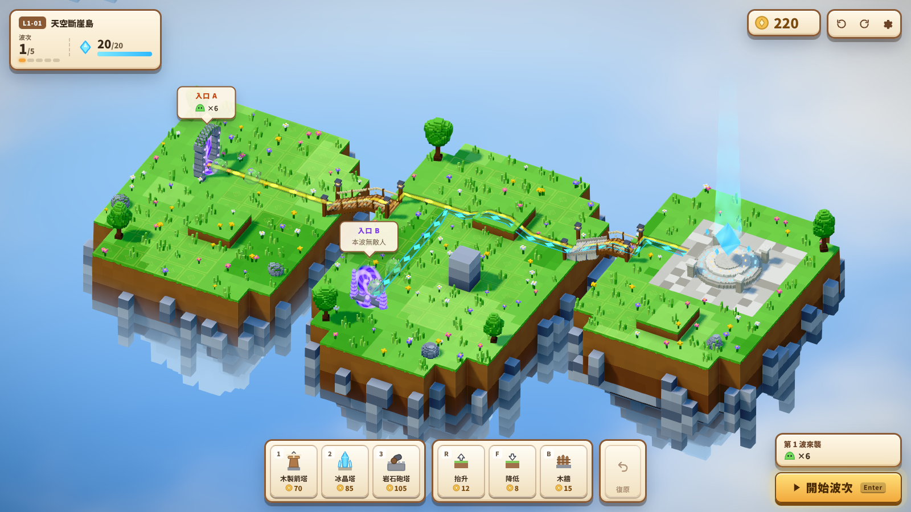

# 天空方塊島：守護之心

多層體素地形塔防：在漂浮群島上改路、爭高地、守護天空之心。



## 開始

```bash
npm install
npm run dev      # http://localhost:5173
npm run build    # 產出 dist/
npm test         # 單元與整合測試
npm run e2e      # 需先 build：瀏覽器冒煙測試（建塔、復原、開波、結算）
npm run e2e:mobile # 需先 build：手機尺寸＋觸控模擬（直式、橫式、Android）
npm run typecheck && npm run lint
```

## 線上遊玩（GitHub Pages）

https://yisotsao.github.io/sky-cube-island/ （手機瀏覽器可直接開啟）

推送到預設分支時，`.github/workflows/deploy-pages.yml` 會自動建置並部署。首次使用需在 GitHub 儲存庫 **Settings → Pages → Build and deployment → Source** 選擇 **GitHub Actions**。也可在 Actions 頁面手動執行「Deploy to GitHub Pages」。

網址參數（測試／截圖用）：`?nointro` 跳過開場、`?visualTest` 凍結動畫、`?cam=0..3` 旋轉視角、`?quality=low|medium|high|ultra`、`?perf` 顯示效能。

## 操作

| 按鍵 | 功能 |
|---|---|
| 1 / 2 / 3 / 4 / 5 | 箭塔／冰晶塔／岩石砲塔／雷光塔／風車塔 |
| R / F | 抬升／降低地形 |
| B | 木牆 |
| Ctrl+Z | 復原（準備期最多 20 步） |
| U / X | 升級／出售選取的塔 |
| T | 切換選取的塔的索敵模式（最前／最後／最強／最近） |
| Tab（按住） | 顯示所有射程 |
| Q / E、滾輪、WASD | 旋轉、縮放、平移 |
| Enter / Space / Esc | 開始波次／暫停／取消 |

### 手機／平板（觸控）

| 手勢 | 功能 |
|---|---|
| 點工具按鈕 | 選擇塔／地形工具（再點一次取消） |
| 點地塊 → 再點同一格 | 第一下預覽位置、花費與新路線；第二下確認 |
| 點塔／牆 | 選取，可升級／出售／拆除 |
| 單指拖曳 | 平移 |
| 雙指捏合／旋轉 | 縮放／旋轉視角 90° |
| ⚙ | 選單（設定、操作說明、回到標題） |

手機預設畫質為「中」（低記憶體或 ≤4 核時為「低」），可在設定中調整。直式與橫式皆可遊玩，橫式視野較大。

## 架構

- `src/domain`、`src/levels`、`src/navigation`、`src/commands`、`src/simulation`、`src/session`：純 TypeScript 模擬核心（20 TPS、確定性），不依賴 three 或 React，ESLint 強制。
- `src/scene`：Three.js 呈現層（貪婪體素網格＋烘焙 AO、shader 倒角、雲海、後處理、戰術疊層、VFX），只透過 `GameEvent` 與 `SceneFeed` 讀資料。
- `src/audio`：程序合成音效與音樂。
- `src/ui`：React HUD（zustand 低頻狀態）。

設計規格見 `docs/01_GAME_DESIGN_DOCUMENT.md`、`docs/02_TECHNICAL_ARCHITECTURE.md`；實作決策見 `docs/DECISIONS.md`。
