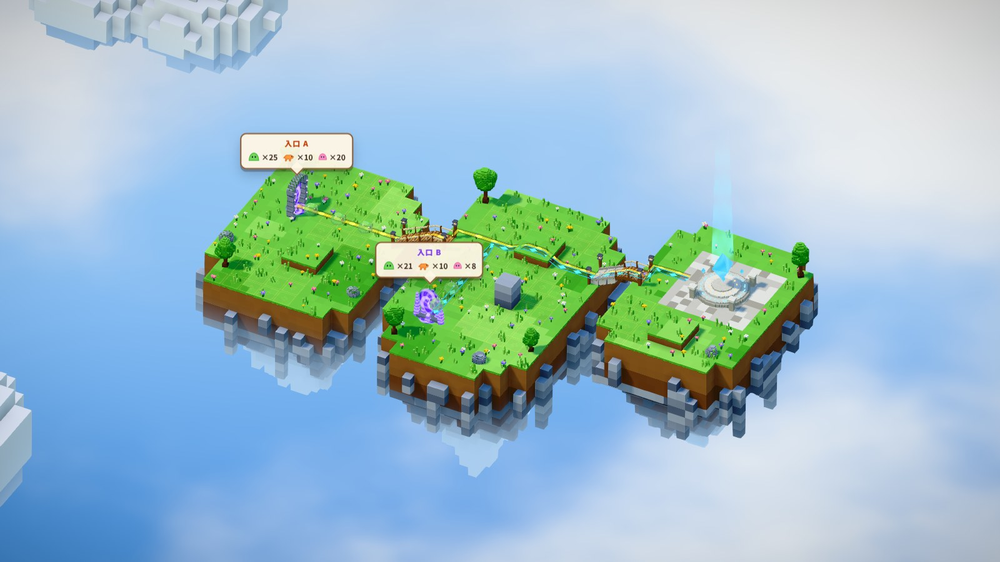
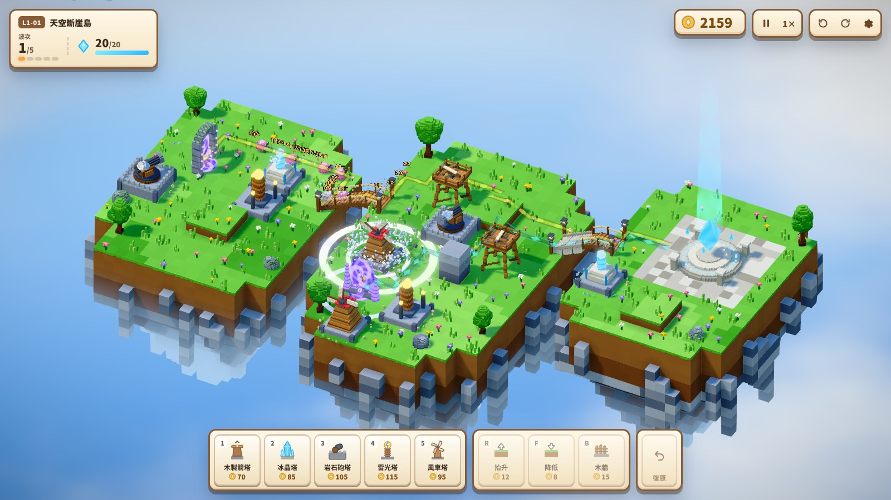
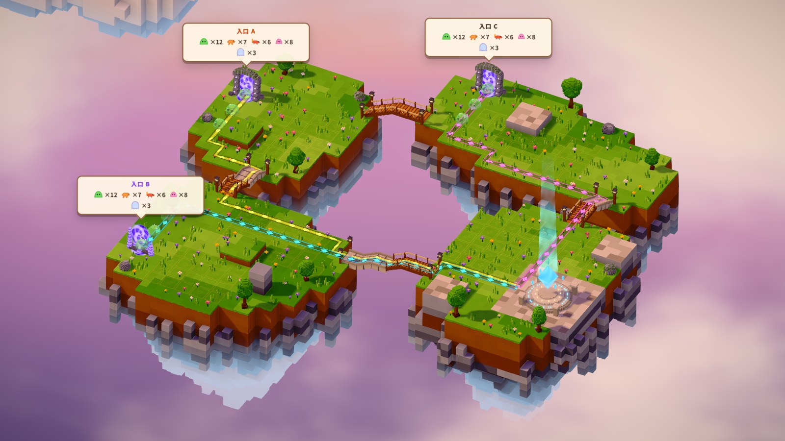
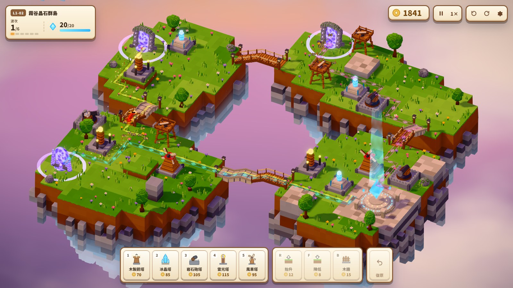
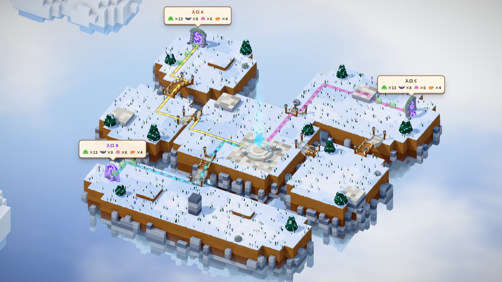
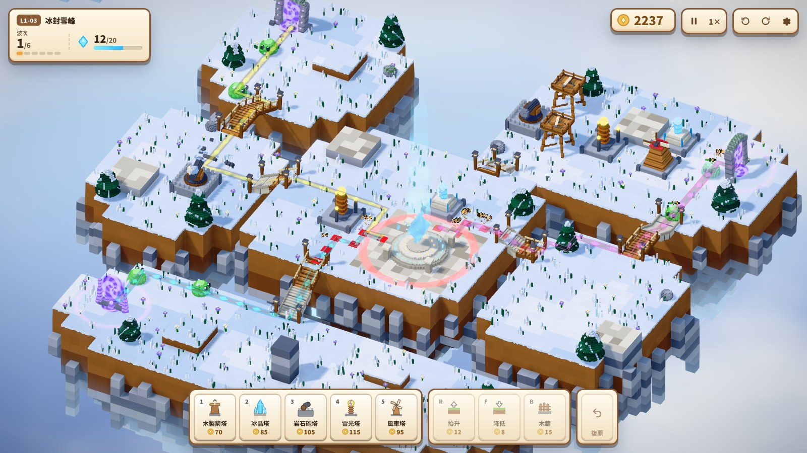
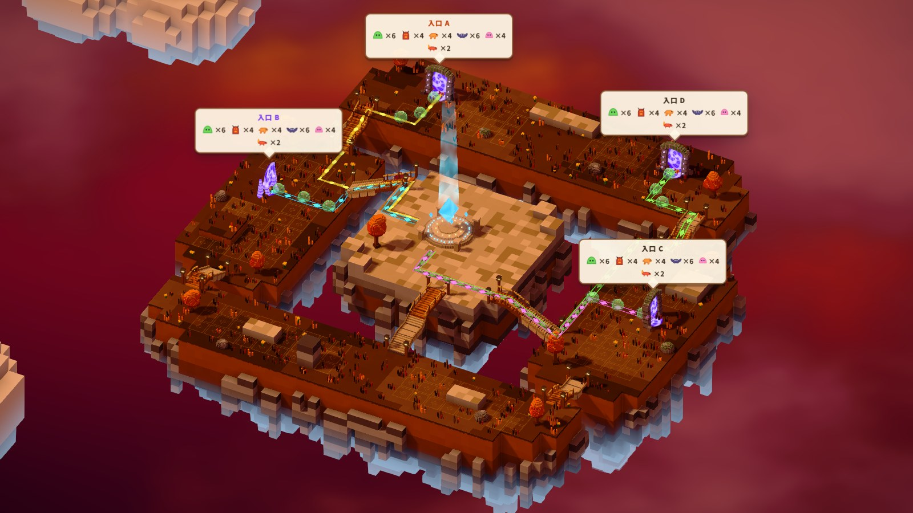
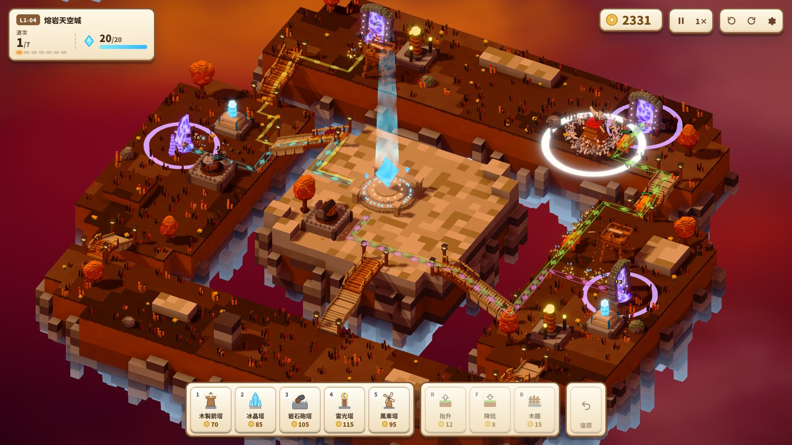

# 關卡圖鑑 Level gallery

四個關卡的地圖截圖。每關兩張：**總覽**（備戰階段、隱藏 HUD，可看到各入口的怪物預覽與行進路線）和**戰鬥中**（沿路線架好塔、第一波進行中，含 HUD）。

截圖由 `tests/e2e/capture-levels.mjs` 自動產生，改了地圖後重新截圖：

```bash
npm run build && node tests/e2e/capture-levels.mjs          # 全部關卡
node tests/e2e/capture-levels.mjs L1-03                     # 只截單一關
```

| 關卡 | 主題 | 波數 | 入口 | 怪物種類 | 初始金幣 |
|---|---|---|---|---|---|
| [L1-01 天空斷崖島](#l1-01-天空斷崖島) | 白天草原 | 5 | 2 | 10 | 300 |
| [L1-02 霧谷晶石群島](#l1-02-霧谷晶石群島) | 黃昏 | 6 | 3 | 14 | 400 |
| [L1-03 冰封雪峰](#l1-03-冰封雪峰) | 雪原 | 6 | 3 | 14 | 560 |
| [L1-04 熔岩天空城](#l1-04-熔岩天空城) | 火山 | 7 | 4 | 19 | 480 |

## L1-01 天空斷崖島

漂浮的三座島，入口 A、B 經木製斜橋與石木坡橋匯流到東側的守護之心。




## L1-02 霧谷晶石群島

三道裂隙、黃昏的四座島。西風木橋、石階坡道、峽谷長橋與北坡吊橋把西岸、南谷、北嶺三路連到核心。




## L1-03 冰封雪峰

風雪中的五座冰島。雪原、南谷、山脊三道裂隙，靠冰階坡道、冰橋與吊橋在中央冰島匯合。




## L1-04 熔岩天空城

四座城門、火山上的最終決戰。外環四島圍住中央城台，四路怪物從西北、西崖、東台、東北同時進攻。



